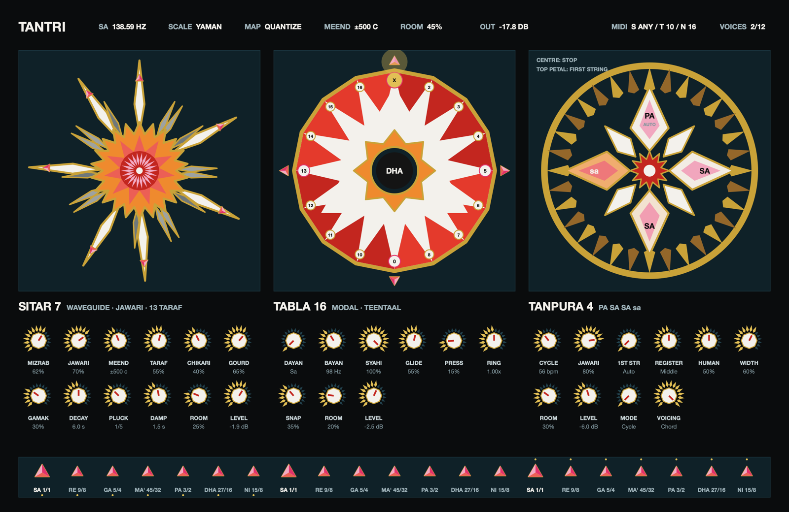
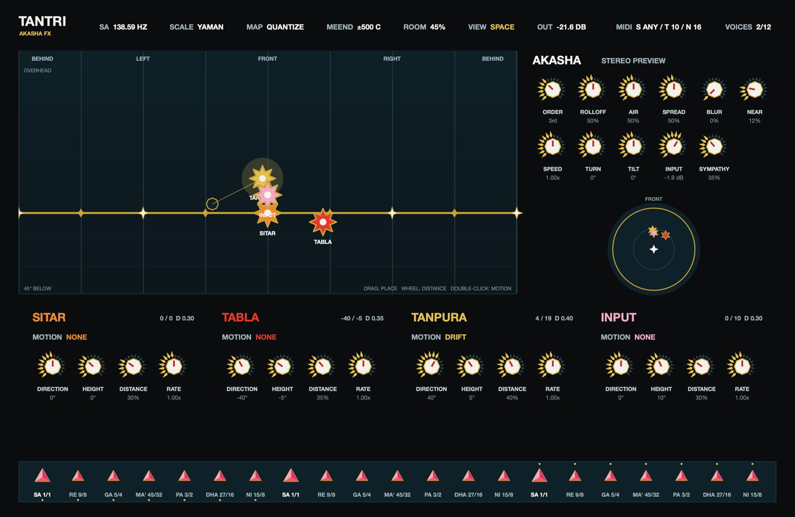

<p align="center"></p>

# tantri

**Sitar, tabla and tanpura**: physically modelled, polyphonic, and tuned in just-intonation shrutis instead of 12-TET. Three plug-ins, for macOS (universal: Apple silicon and Intel) and Windows:

| | | Formats |
|---|---|---|
| **Tantri** | the stereo instrument | VST3 · AU · VST2 · app |
| **Tantri Akasha** | the instrument in space: sitar, tabla and tanpura as moving Ambisonic sources (1st–7th order) | VST3 · AU · VST2 · app (stereo preview) |
| **Tantri Akasha FX** | the same as an effect: the input becomes a fourth moving source and rings the sitar's sympathetic strings | VST3 · AU · VST2 |

Download the latest build for your system from [Releases](../../releases).



The full guide is [`docs/manual/Tantri Manual.pdf`](docs/manual/Tantri%20Manual.pdf), 14 pages, including how the waveguide strings and the modal tabla work.

## What's inside

| | Model | Highlights |
|---|---|---|
| **Sitar** | 2× oversampled digital waveguide, two polarisations, 12 voices | Passive nonlinear **jawari** bridge (Pierce–Van Duyne lattice allpasses driven by the string's own displacement); 13 **taraf** sympathetic strings tuned to the raga; 2 **chikari**; 14-mode gourd body; da/ra mizrab strokes |
| **Tabla** | Modal synthesis: complex one-pole resonators | Dayan modes pulled onto Raman's harmonic series by the **syahi** (continuous from a plain membrane to fully loaded); Bessel mode shapes set each stroke's excitation; damping fingers persist between strokes; degenerate mode pairs beat; tension modulation; bayan wrist pressure and Ghe glide |
| **Tanpura** | Four jawari strings, two polarisations each | Classic Pa–Sa–Sa–sa cycle with a pause; **Auto** first string (Pa, else Ma, else Ni, from the raga); thread jawari swirl; slow drift; humanised plucking. **Drone mode**: the strings are bowed (a pulse locked to each string's period, level held by a control loop) and sound on without decay, as a **single note** or a **chord** of any of the four strings, no MIDI needed |

**Tuning.** Sa is set in Hz, and every pitch is Sa × a ratio from the chosen **scale**. There are 145: 42 Hindustani ragas (each with its own shrutis and andolan swaras), the 10 thaats, all **72 Carnatic melakartas**, and microtonal systems (all 22 shrutis, Partch 43, harmonic and subharmonic series, Pythagorean, 17/19/22/24/31/41/53/72-EDO), plus maqamat and gamelan. Incoming MIDI is **quantised** to the scale (nearest pitch), or with **Steps** each key is the next degree, which reaches every pitch of dense scales. Swara scales can be edited live on the shruti star.

**Measured** (`TantriTest --pitch`): 266 notes across ragas, a melakarta, 22 shrutis, Partch 43, 53-EDO and Rast; worst error **0.23 cents** without jawari and **1.5 cents** with it.

**Playing.** Pitch-bend gives meend (never quantised). Poly or channel aftertouch glides a note to the next raga swara, and the mod wheel adds gamak. Keys 36–47 play tabla bols, and so does channel 10. Keys below 36 strike the chikari.

**Output.** The instruments are balanced so default playing peaks at about −3 dBFS. A stereo-linked look-ahead limiter (−1 dBFS ceiling, 1.5 ms latency reported to the host) means the output never clips. The **OUT** meter shows the pre-limiter peak and any gain reduction.

## Tantri Akasha (spatial)



The same space as openfield and the other spatial instruments: an ACN/SN3D (AmbiX) encoder up to 7th order, openfield's distance model (rolloff, air, near spread, blur, near radius), scene turn and tilt, and twelve motions per source: orbit, swing, rise, drift, spiral, figure 8, arc, approach, hop, flutter, **boids** (one flock of every source on it) and **Lorenz** (each source its own stretch of the attractor). Drag the sources on the unrolled sphere, scroll for distance, double-click for a motion. VST3/VST2 offer up to 64 channels, AU 3rd order; stereo tracks and the app get a first-order stereo preview. A look-ahead limiter on all channels with one shared gain keeps every channel under −1 dBFS.

## Build

```sh
git submodule update --init          # JUCE
cmake -B build-release -G Ninja -DCMAKE_BUILD_TYPE=Release -DTANTRI_COPY_AFTER_BUILD=ON
cmake --build build-release --target Tantri_All TantriAkasha_All TantriAkashaFX_All
```

`TANTRI_COPY_AFTER_BUILD` installs into `~/Library/Audio/Plug-Ins/{Components,VST3,VST}`. The apps are in `build-release/<Target>_artefacts/Release/Standalone/`. On Windows: `cmake -B build -A x64` then `cmake --build build --config Release --target Tantri_All TantriAkasha_All TantriAkashaFX_All`. GitHub Actions builds and tests macOS and Windows on every push; a `v*` tag makes a release. VST2 uses the FST headers in `third_party/vst2-fst`; turn it off with `-DTANTRI_BUILD_VST2=OFF`.

## Tests and renders

```sh
cmake -B build -G Ninja -DCMAKE_BUILD_TYPE=Release -DCMAKE_OSX_ARCHITECTURES=arm64
cmake --build build --target TantriTest TantriAkashaTest TantriAkashaFXTest
T=build/TantriTest_artefacts/Release/TantriTest
$T                    # no arguments: pitch, drone, stress (+ space in the Akasha runners)
$T --pitch            # every swara vs its just ratio, in cents
$T --drone            # the drone holds its level (no decay), single and chord
build/TantriAkashaFXTest_artefacts/Release/TantriAkashaFXTest --space   # encoding, motions, flock, ceiling, input
$T --stress           # 60 s of random MIDI: finite, bounded
$T --levels           # peak / RMS per instrument, limiter activity
$T --cpu              # real-time factor
$T --wav demos        # Yaman alap, teentaal theka, tanpura, full mix
$T --shot ui.png      # editor screenshot
```

## Layout

```
Source/Tuning.h      shrutis, swaras, ragas
Source/Scales.h      scale library (145) + quantize / steps key mapping
Source/Dsp.h         ContactString (waveguide + jawari), SympString, ModalBody, FDN reverb, Limiter, LimiterN
Source/Sitar.h       voices, meend/gamak/andolan, taraf, chikari, gourd
Source/Tabla.h       modal drums, strokes (bols), bayan pressure
Source/Tanpura.h     four-string pluck cycle and the bowed drone
Source/Space.h       Tantri Akasha: motions, flock, Lorenz, distance model, encoder (after openfield)
Source/Ambi.h        SN3D real spherical harmonics, ACN, up to 7th order
Source/PluginEditor  the E "Grace" look: shruti star, teentaal ring, tanpura flower, star knobs
docs/manual          manual.html → Tantri Manual.pdf (headless Chrome)
mockups              the six look options shown before the UI was designed
tests/Test.cpp       TantriTest; tests/lab = single-string experiments
```

Every request that shaped Tantri is in [REQUESTS.md](REQUESTS.md).

## References

C. V. Raman, *The Indian musical drums* (1934) · J. O. Smith, *Physical Audio Signal Processing* · J. R. Pierce & S. A. Van Duyne, *A passive nonlinear digital filter design…*, JASA 101 (1997) · S. Siddiq, *A physical model of the nonlinear sitar string*, Archives of Acoustics 37 (2012) · V. Välimäki et al., *Discrete-time modelling of musical instruments* (2006).
